# UtiliStore UX/UI — Entregas 02 a 05: Pesquisa, jornadas, arquitetura e fluxos

14/11/2026 · Gabriel Luis Barbosa Souza

Documento editável: https://claude.ai/artifact/F88Hu6jRo57qQD3somStP5

Continuação da Entrega 01 (Análise do repositório). Este documento define **para quem** o UtiliStore é desenhado, **como** essas pessoas o usam e **como** as telas se organizam e se conectam. Nenhuma tela visual é desenhada aqui: isso começa na Entrega 06.

## Premissas aprovadas

1. **Escopo completo com dados de demonstração.** Telas sem backend (catálogo, produto, carrinho, checkout, pedidos e toda a área administrativa) serão projetadas, e todo conteúdo delas será marcado como **Demonstração** no protótipo.
2. **Identidade visual:** mantém-se o azul-marinho atual do UtiliStore (`#112058` / `#1c3080`) como cor principal; o laranja entra como cor de destaque.
3. **Formato:** documentação em Docs; wireframes e protótipo navegável em canvas de design.
4. **Contrato técnico respeitado:** campos, mensagens de erro e status usados nas telas são os que existem no repositório. Onde não existem, o texto diz "proposto".

Legenda de situação usada em todo o documento: **Real** = existe na API hoje · **Real (pendente)** = rota escrita no backend, aguardando correção da equipe · **Demo** = sem backend, só demonstração.

## Entrega 02 — Pesquisa e personas

### Método e limites

As personas abaixo são **proto-personas**: hipóteses construídas a partir do briefing, do público típico de lojas de utilidades e das funcionalidades do repositório. Não há entrevistas nem dados de uso por trás delas. Para a apresentação acadêmica, recomenda-se validá-las com 3 a 5 conversas curtas com pessoas reais de cada perfil antes da Entrega 11 (avaliação de usabilidade).

### Persona 1 — Cliente principal: Mariana Alves

| Atributo | Descrição |
|---|---|
| Idade | 34 anos |
| Ocupação | Auxiliar administrativa; mãe de duas crianças; mora em Anápolis (GO) |
| Familiaridade com tecnologia | Média. Usa o celular para quase tudo, compra em marketplaces grandes, evita computador fora do trabalho |
| Objetivos | Comprar utilidades de casa (cozinha, limpeza, organização) de forma rápida e pelo menor preço justo |
| Necessidades | Encontrar o produto em poucos toques; ver preço final em R$ sem surpresa; saber quando o pedido chega |
| Dificuldades | Pouco tempo, compra em intervalos curtos; digita mal em formulários longos no celular; esquece senhas |
| Frustrações | Ser obrigada a se cadastrar antes de ver produtos; checkout que pede os mesmos dados de novo; não saber o status do pedido |
| Comportamentos | Navega à noite pelo celular; compara preços em outras lojas antes de comprar; prefere entrar com o telefone a lembrar qual e-mail usou |
| Expectativas | Cadastro curto, login por e-mail **ou telefone**, carrinho que não some, confirmação clara a cada ação |

Por que importa para o projeto: Mariana justifica o **mobile como contexto principal** da área do cliente e o uso do login por telefone, que a API já suporta e a tela atual bloqueia.

### Persona 1b — Cliente secundário: José Ferreira

| Atributo | Descrição |
|---|---|
| Idade | 63 anos |
| Ocupação | Aposentado; cuida da manutenção da própria casa |
| Familiaridade com tecnologia | Baixa. Usa tablet com fonte ampliada; compra on-line com ajuda da filha |
| Objetivos | Comprar ferramentas e utilidades sem precisar ir à loja física |
| Necessidades | Textos grandes e legíveis, botões fáceis de tocar, mensagens de erro que digam o que fazer |
| Dificuldades | Ícones sem texto, campos que rejeitam o formato que ele digitou, sessão que expira no meio da compra |
| Frustrações | "Erro" sem explicação; perder o que já tinha preenchido |
| Comportamentos | Lê tudo antes de clicar; desiste quando não entende o próximo passo |
| Expectativas | Ser guiado passo a passo, com confirmação antes de pagar |

Por que importa para o projeto: José é o motor dos critérios de **acessibilidade** (WCAG 2.2): contraste, tamanho de alvo de toque, rótulos visíveis e mensagens de erro acionáveis.

### Persona 2 — Administrador: Rafael Costa

| Atributo | Descrição |
|---|---|
| Idade | 29 anos |
| Ocupação | Responsável pelo e-commerce da UtiliStore: catálogo, pedidos e atendimento |
| Familiaridade com tecnologia | Alta. Usa planilhas, sistemas de gestão e atalhos de teclado |
| Objetivos | Manter o catálogo correto, despachar pedidos no prazo e acompanhar o desempenho da loja |
| Necessidades | Ver primeiro o que precisa de ação hoje; encontrar qualquer produto, pedido ou cliente pela busca; editar rápido |
| Dificuldades | Muitos produtos parecidos; trabalha interrompido (telefone, estoque); usa desktop no escritório e, às vezes, tablet no estoque |
| Frustrações | Excluir algo por engano; perder um formulário longo ao sair da página; indicadores sem contexto |
| Comportamentos | Abre o painel no início do expediente; filtra pedidos por status várias vezes ao dia |
| Expectativas | Tabelas com busca, filtro e ordenação; ações destrutivas com confirmação; status padronizados |

Por que importa para o projeto: Rafael orienta o painel para **produtividade** (densidade de informação, tabelas e filtros) em vez de vitrine.

## Entrega 03 — Jornada do usuário

### Jornada da cliente (Mariana)

| Etapa | Ação | Objetivo | Pensamentos | Emoção | Dificuldades | Oportunidades | Situação |
|---|---|---|---|---|---|---|---|
| 1. Descoberta | Recebe um link ou anúncio e abre a loja no celular | Ver se a loja tem o que procura | "É confiável? Tem o que eu quero?" | Curiosa, desconfiada | Hoje a entrada do site é o login: não há o que ver antes de entrar | Página inicial pública com categorias, ofertas e sinais de confiança | Demo |
| 2. Acesso | Entra ou cria conta | Poder comprar e acompanhar pedidos | "Qual e-mail eu usei?" | Impaciente | Login só por e-mail na tela; cadastro com CPF que não é usado | Campo "E-mail ou telefone"; cadastro com 4 campos; login só quando necessário | Real (login) / Demo (cadastro) |
| 3. Navegação | Percorre categorias e ofertas | Achar ideias e preços bons | "Onde ficam as coisas de cozinha?" | Explorando | Hoje a vitrine fica misturada ao painel da conta | Menu de categorias fixo no header; vitrine separada da conta | Demo |
| 4. Pesquisa | Digita o nome do produto | Ir direto ao item | "Será que é 'pote' ou 'recipiente'?" | Focada | Termos diferentes para o mesmo item; nenhum resultado sem sugestão | Busca sempre visível; estado "nenhum resultado" com sugestões e categorias | Demo |
| 5. Detalhes | Abre o produto | Confirmar preço, tamanho e disponibilidade | "Cabe no meu armário?" | Avaliando | Informações espalhadas; dúvida sobre estoque | Preço, disponibilidade e botão de compra no topo; descrição depois | Demo |
| 6. Carrinho | Adiciona e revisa | Juntar itens e ver o total | "Quanto deu tudo?" | Satisfeita, atenta | Hoje o carrinho é só um contador | Confirmação ao adicionar, total sempre visível, quantidade editável | Demo |
| 7. Finalização | Confirma dados, endereço e pagamento | Concluir sem retrabalho | "Vai pedir tudo de novo?" | Ansiosa | Formulário longo; sessão de 2 h pode expirar | Dados do cliente puxados da conta; endereços salvos; etapas numeradas | Real (pendente) para dados e endereço / Demo para pagamento |
| 8. Acompanhamento | Consulta "Meus pedidos" | Saber quando chega | "Já saiu?" | Expectativa | Sem status claro, a pessoa liga ou desiste da loja | Linha do tempo com os status Pago → Em preparação → Enviado → Entregue (e Cancelado) | Demo |

Momento crítico: a **etapa 2**. É onde a Mariana mais pode desistir, e é a única parte em que o sistema já tem backend real — vale o maior cuidado de projeto.

### Jornada do administrador (Rafael)

| Etapa | Ação | Objetivo | Pensamentos | Emoção | Dificuldades | Oportunidades | Situação |
|---|---|---|---|---|---|---|---|
| 1. Acesso administrativo | Entra pelo endereço do painel | Começar o expediente | "Espero não cair na loja do cliente" | Rotina | Não existe papel de administrador; o seletor "Vendedor" das telas atuais confunde | Login administrativo separado, com identidade própria do painel | Demo |
| 2. Dashboard | Vê o resumo do dia | Saber o que fazer primeiro | "Tem pedido parado?" | Alerta | Indicadores sem contexto viram ruído | Cartões com ação: "X pedidos aguardando preparo" leva à lista já filtrada | Demo |
| 3. Indicadores | Consulta totais e gráficos | Acompanhar desempenho | "Isso é bom ou ruim?" | Analítico | Número sem comparação não diz nada | Período visível e rótulo "Dados de demonstração" em todo indicador | Demo |
| 4. Produtos | Busca, cadastra, edita, exclui | Catálogo correto | "Qual destes é o certo?" | Concentrado | Formulário longo; exclusão acidental | Busca e filtros na listagem; formulário em seções; confirmação ao excluir; aviso ao sair sem salvar | Demo |
| 5. Pedidos | Filtra por status e atualiza | Despachar no prazo | "Quais faltam enviar?" | Pressionado | Muitos pedidos misturados | Filtros por status (os mesmos 5 do cliente); detalhe com cliente, itens, valor e histórico | Demo |
| 6. Clientes | Procura um cliente | Responder um atendimento | "Quem é essa pessoa e o que comprou?" | Prestativo | Dados espalhados | Ficha com dados cadastrais (nome, e-mail, telefone), endereços e pedidos | Demo (o modelo de dados de cliente é o real) |
| 7. Tarefas administrativas | Ajusta configurações e sai | Fechar o expediente | "Salvou?" | Alívio | Falta de confirmação após salvar | Feedback de sucesso em toda gravação; sair sempre visível | Demo |

Momento crítico: a **etapa 2**. Se o dashboard não mostrar o que exige ação, o Rafael passa a ignorá-lo e vai direto para as listas.

### Problemas de usabilidade previstos e soluções

| Problema | Onde aparece | Solução de projeto |
|---|---|---|
| Excesso de informações | Dashboard do cliente atual (pedidos, ofertas, produtos e notificações juntos) | Separar Loja e Minha conta; cada tela com uma tarefa principal |
| Navegação confusa | Itens de menu que levam a "ainda não implementada" | Todo item do menu leva a uma tela; breadcrumb nas páginas internas |
| Dificuldade para encontrar produtos | Sem categorias; busca só dentro do painel | Busca no header de todas as páginas; menu de categorias; filtros e ordenação no catálogo |
| Formulários extensos | Cadastro com 7 campos (incluindo CPF sem uso) | Cadastro com nome, e-mail, telefone, senha e confirmação; checkout reaproveita os dados da conta |
| Falta de feedback | Carrinho só com contador; sessão expira em silêncio | Aviso ao adicionar ao carrinho; estados de carregamento em botões; aviso "Sua sessão expirou" |
| Erros de preenchimento | Login rejeita telefone; regras de senha diferentes (4 x 6) | Aceitar e-mail ou telefone; regra única de mínimo 6 caracteres mostrada antes do erro; erro junto ao campo |
| Dificuldade no processo de compra | Inexistente hoje | Checkout em etapas numeradas: Identificação → Entrega → Pagamento → Revisão |
| Falta de clareza | Cadastro mostra sucesso sem gravar | Estados reais de sucesso e erro; dados de demonstração sempre rotulados |
| Responsividade | Tabela de pedidos e grade de produtos | Tabela vira lista de cartões no mobile; menu lateral vira gaveta; alvos de toque de pelo menos 44 px |

## Entrega 04 — Arquitetura da informação

### Princípios

1. **Loja aberta, conta quando necessário.** A página inicial deixa de ser o login: o visitante navega, pesquisa e monta o carrinho; o login é pedido só ao finalizar a compra ou abrir "Minha conta". (Mudança apenas de front-end; o backend continua igual.)
2. **Duas áreas, duas portas.** Cliente e administrador têm entradas, navegação e identidade de cabeçalho próprias. O seletor "Usuário / Vendedor" sai das telas.
3. **Conta separada da vitrine.** "Minha conta" reúne só o que é do cliente: dados, segurança, endereços e pedidos.
4. **Rotas protegidas voltam ao lugar certo.** Ao abrir uma tela protegida sem sessão (ou com token expirado), a pessoa vai ao login e, depois de entrar, retorna à tela que tentava abrir.

### Área do cliente

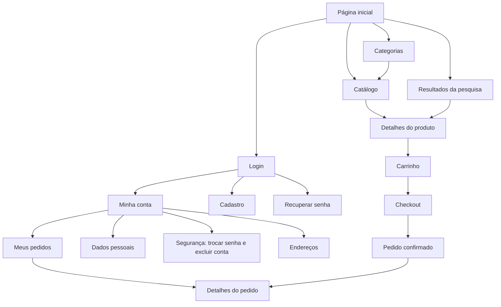

**Navegação global (todas as telas da loja):** header com logo, barra de pesquisa, menu de categorias, acesso à conta ("Entrar" ou o nome do cliente) e carrinho com contador; rodapé com institucional e atendimento. No mobile, categorias e conta vão para um menu em gaveta e a pesquisa fica logo abaixo do header.

| Tela | Função | Acesso | Situação | Base técnica |
|---|---|---|---|---|
| Página inicial | Vitrine: banner, categorias e produtos em destaque, ofertas | Público | Demo | — |
| Login | Entrar com e-mail ou telefone + senha | Público | **Real** | `POST /api/auth/login` |
| Cadastro | Criar conta (nome, e-mail, telefone, senha) | Público | Demo (endpoint inexistente) | Campos da tabela `clientes` |
| Recuperar senha | Pedir link de redefinição | Público | Demo | — |
| Catálogo | Grade com filtros, ordenação e preços | Público | Demo | — |
| Categorias | Entrada por tipo de produto | Público | Demo | — |
| Pesquisa | Resultados para o termo digitado | Público | Demo | — |
| Detalhes do produto | Imagens, descrição, preço, disponibilidade, quantidade | Público | Demo | — |
| Carrinho | Itens, quantidade, remoção, subtotal e total | Público | Demo | — |
| Checkout | Identificação, entrega, pagamento, revisão | Logado | Real (pendente) para identificação e endereço; Demo para pagamento | `GET /api/auth/me`, `/api/enderecos` |
| Minha conta → Dados pessoais | Ver e editar nome, e-mail, telefone | Logado | Real (pendente) | `GET /api/auth/me`, `PUT /api/clientes/me` |
| Minha conta → Segurança | Trocar senha; excluir conta com senha | Logado | Real (pendente) | `PUT /api/clientes/me/senha`, `DELETE /api/clientes/me` |
| Minha conta → Endereços | Listar, criar, editar e excluir endereços | Logado | Real (pendente) | `/api/enderecos` |
| Meus pedidos | Lista com filtro por status | Logado | Demo | Status do `dashboard.js` atual |
| Detalhes do pedido | Itens, valor, data e linha do tempo de status | Logado | Demo | — |

### Área administrativa

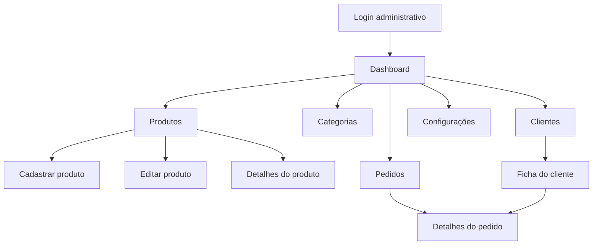

**Navegação global do painel:** menu lateral fixo (Dashboard, Produtos, Categorias, Pedidos, Clientes, Configurações) e cabeçalho com busca geral, nome do administrador e "Sair". Em tablet o menu recolhe para ícones com rótulo; em mobile vira gaveta. Toda tela do painel exibe a etiqueta **Dados de demonstração**, porque nenhuma delas tem backend.

| Tela | Função | Situação |
|---|---|---|
| Login administrativo | Entrada exclusiva do painel | Demo (não há papel de administrador no banco nem no token) |
| Dashboard | Indicadores e o que exige ação hoje | Demo |
| Produtos | Listagem com busca, filtros e ações | Demo |
| Cadastrar / Editar produto | Formulário em seções | Demo |
| Categorias | Criar, renomear e remover categorias | Demo |
| Pedidos | Listagem filtrável por status | Demo |
| Detalhes do pedido | Cliente, itens, valor, status e histórico | Demo |
| Clientes | Listagem e busca | Demo (campos reais da tabela `clientes`) |
| Ficha do cliente | Dados cadastrais, endereços e pedidos | Demo (campos reais de `clientes` e `enderecos`) |
| Configurações | Dados da loja e do administrador | Demo |

### Relacionamentos entre as áreas

- O **Detalhe do pedido** existe nas duas áreas com o mesmo conteúdo-base e os mesmos 5 status (Pago, Em preparação, Enviado, Entregue, Cancelado); o administrador ganha as ações de mudar status.
- A **Ficha do cliente** do painel mostra exatamente os campos que o cliente edita em "Minha conta" (nome, e-mail, telefone, endereços), garantindo que as duas áreas falem da mesma entidade.
- O **Produto** cadastrado no painel é o mesmo exibido no catálogo; o formulário do painel e a página de detalhes compartilham os mesmos campos (nome, descrição, preço, preço anterior, disponibilidade, categoria, imagens) — todos **propostos**, já que não existe tabela de produtos.

## Entrega 05 — Fluxos de navegação

Cada fluxo mostra ponto inicial, ações, decisões (losangos), validações, mensagens de erro, caminhos alternativos e resultado. Mensagens entre aspas marcadas como **API** são as que o backend devolve hoje; as demais são **propostas** para o protótipo.

### Fluxo 1 — Cadastro de cliente (Demo)

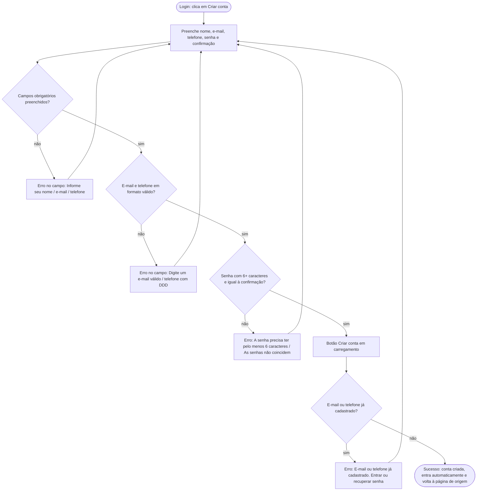

O CPF sai do formulário (não existe no banco). A mensagem de duplicidade reaproveita o texto que a API já usa no `PUT /api/clientes/me` (409). No protótipo, o sucesso é simulado e rotulado como demonstração.

### Fluxo 2 — Login de cliente (Real)

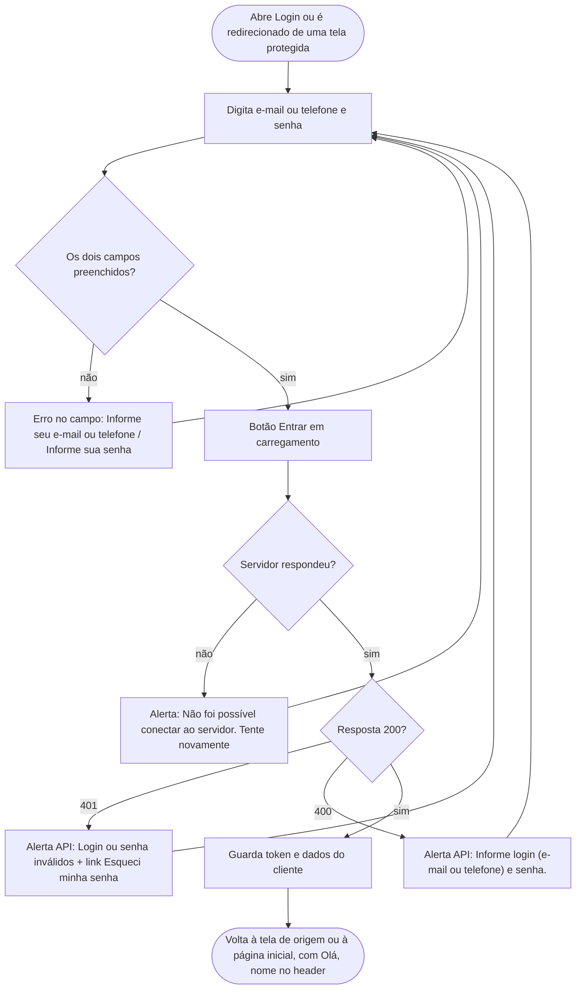

Caminho alternativo: com o token expirado (2 h), qualquer chamada protegida devolve 401 "Token inválido ou expirado."; a interface mostra "Sua sessão expirou, entre novamente" e reinicia este fluxo guardando a tela de origem.

### Fluxo 3 — Recuperação de senha (Demo)

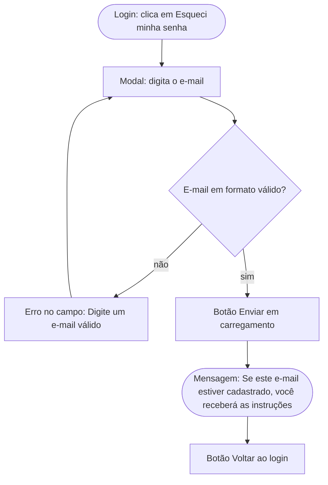

A mensagem final é a mesma exista ou não a conta, seguindo a mesma política da API no login (não revelar se o e-mail existe).

### Fluxo 4 — Pesquisa e navegação de produtos (Demo)

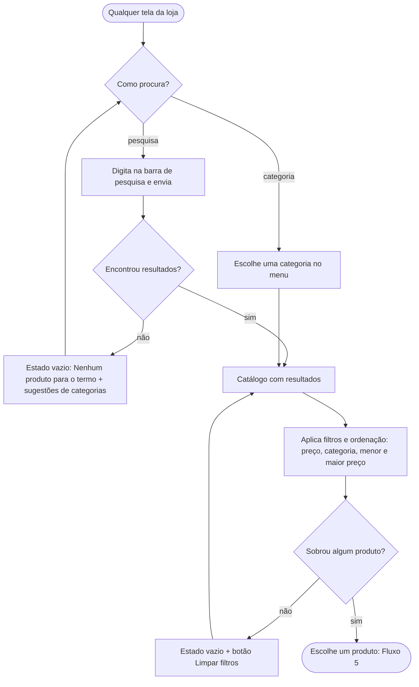

### Fluxo 5 — Visualização de produto (Demo)

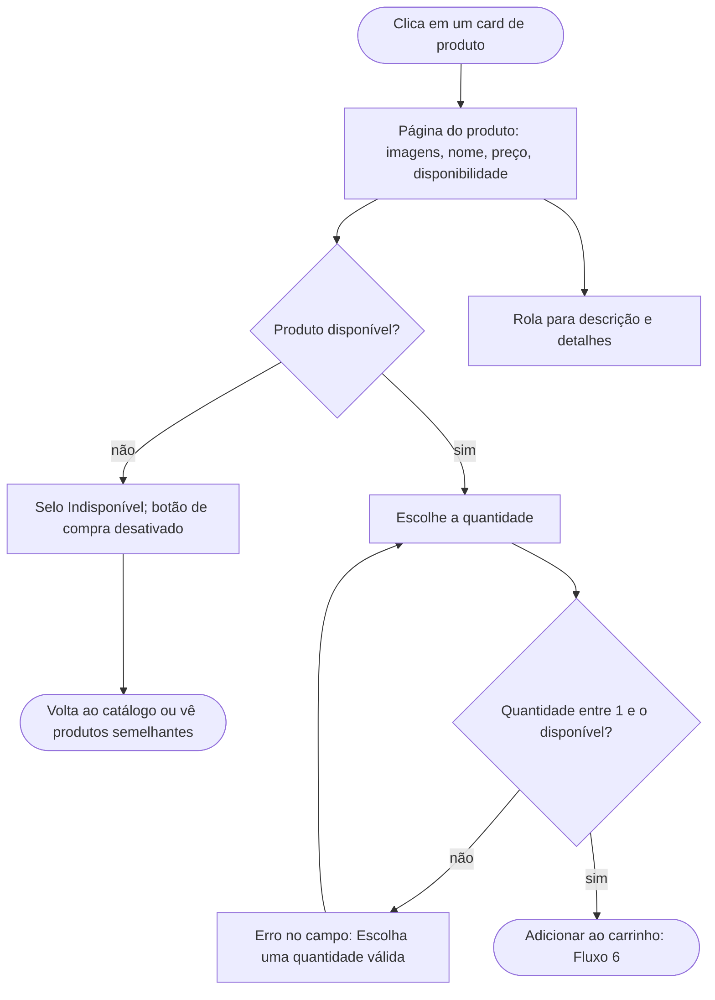

### Fluxo 6 — Adição ao carrinho (Demo)

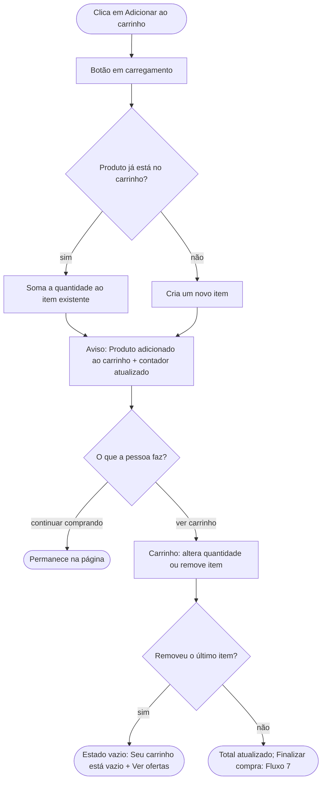

O carrinho funciona para visitantes; o login só é pedido na finalização.

### Fluxo 7 — Finalização da compra (Real pendente + Demo)

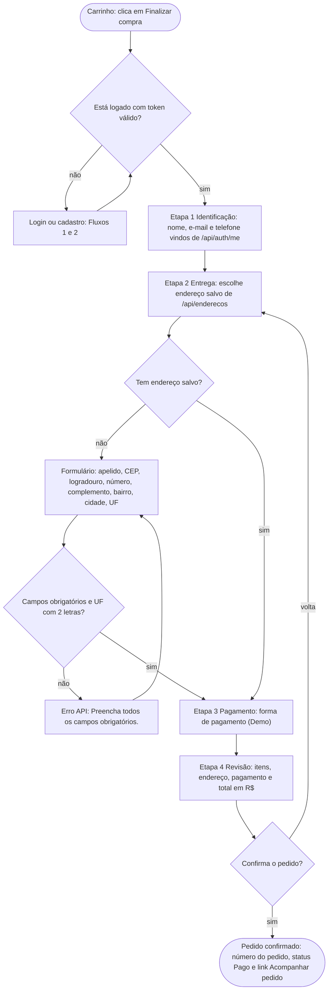

Identificação e endereços usam rotas reais (endereços dependem da correção do backend). Pagamento e criação do pedido são demonstração: não há integração nem tabela de pedidos.

### Fluxo 8 — Login administrativo (Demo)

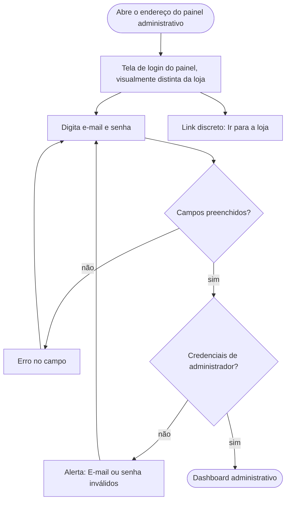

O login de cliente atual **não** pode ser reaproveitado para administradores: não há papel (`role`) no banco nem no token. O fluxo é de demonstração até existir esse suporte.

### Fluxo 9 — Cadastro e gerenciamento de produtos (Demo)

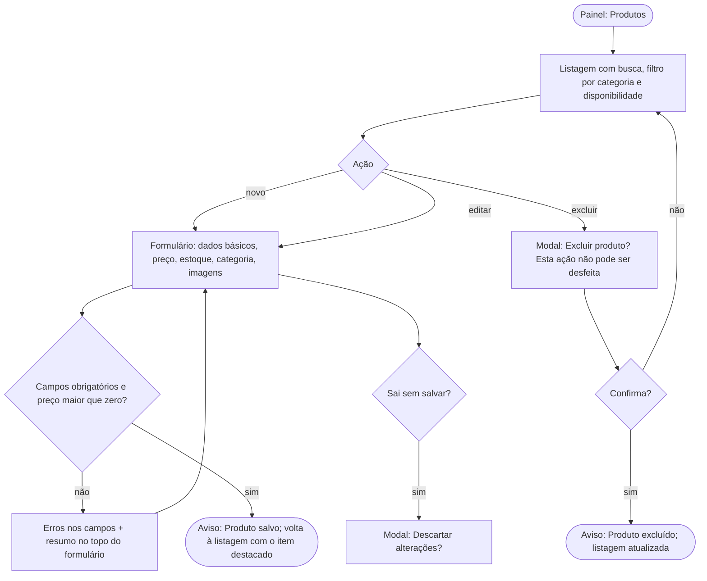

### Fluxo 10 — Gerenciamento de pedidos (Demo)

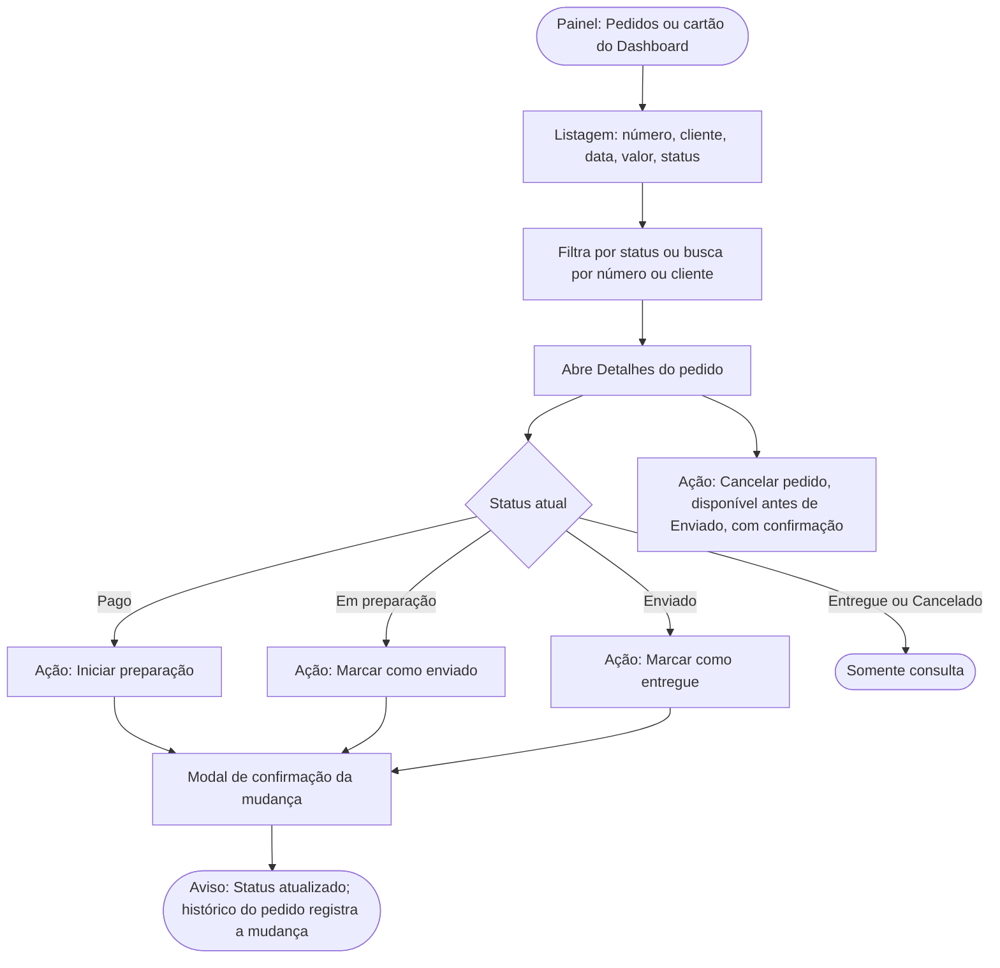

Os cinco status são os que já existem no `dashboard.js` do cliente, para que cliente e administrador vejam a mesma linguagem. A ordem das transições é **proposta**: não há regra de negócio de pedidos no repositório.

## Próximo passo

Com personas, jornadas, arquitetura e fluxos aprovados, a Entrega 06 define o Design System (cores a partir do azul-marinho atual com laranja de destaque, tipografia Inter, componentes e seus 8 estados) e a Entrega 07 traz os wireframes de baixa fidelidade de todas as telas listadas acima, para aprovação antes da alta fidelidade.
